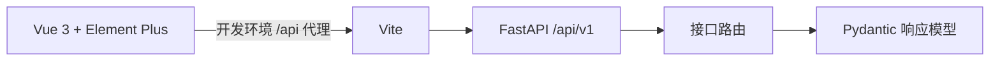

# 项目架构

## 目标与边界

采用 FastAPI + Vue 3 + Element Plus，初始化可启动、可构建、可联通的前后端基础工程。当前没有业务数据和身份认证需求，因此暂不接入数据库、缓存、任务队列或权限框架。健康检查只反映 API 进程可用，不代表后续外部依赖可用。

## ADR-001：同仓库、前后端分离

- 状态：本次初始化采用。
- 决策：后端放在 `backend/`，前端放在 `frontend/`，说明文档放在 `docs/`。两端独立安装、启动和部署。
- 备选：根目录平铺适合更小的示例，但混合构建产物和配置；独立仓库或微服务方便独立团队交付，但当前增加协调与部署成本。
- 取舍：统一管理接口契约，保留独立部署能力；跨端修改需要同时验证。
- 兼容：根目录 `main.py` 和 requirements 文件作为兼容入口，原有启动方式以及 `/`、`/health` 保留。

## ADR-002：渐进式模块化

- 决策：后端使用应用工厂，按 `api/v1/endpoints`、`core`、`schemas` 划分；前端按 `api`、`components`、`router`、`views`、`styles`、`types` 划分。
- 取舍：当前不建立空的服务和数据库抽象；出现业务逻辑后再添加 `services/`，接入数据库后再添加 `models/`、`db/` 和迁移目录。前端需要跨页面状态时再引入 Pinia。
- 接口：新接口归入 `/api/v1`。请求封装集中管理前缀、超时和 HTTP 错误；具体业务错误处理随接口契约扩展。

## ADR-003：开发代理与环境配置

- 决策：Vite 将 `/api` 转发到 FastAPI，浏览器采用相对路径；后端由 pydantic-settings 加载 `backend/.env`，前端使用 Vite 环境变量。
- 安全：只允许指定开发来源跨域；`.env` 不提交。任何 `VITE_` 变量都会进入浏览器构建，禁止存放密钥。
- 失败处理：请求设置 8 秒超时，连接失败展示可重试状态，不伪造正常结果。
- 运维：生产环境用反向代理提供前端静态文件及 `/api` 转发，并为 Vue history 路由配置回退到 `index.html`。Vite 代理只用于开发，`vite preview` 不负责后端转发。正式部署按实际域名配置 CORS 和 HTTPS。
- 验证：后端测试覆盖旧接口、新接口、OpenAPI 和 CORS 来源边界；前端执行 TypeScript 检查及生产构建；开发代理通过真实 HTTP 请求验证。
